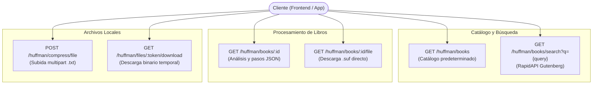

# Especificación del Formato Huffman y Endpoints de la API

Este documento contiene la especificación oficial técnica acordada para el servicio de compresión mediante el **Algoritmo de Huffman** y el formato binario propietario **`.suf` (SUF1)** en el backend de visualización de algoritmos.

---

## 1. Convenciones y Reglas del Algoritmo

Para garantizar total sincronía y determinismo entre la lógica del backend, el archivo binario generado y las animaciones visuales en el frontend, se establecen las siguientes reglas invariantes:

### 1.1. Normalización del Texto
1. **Delimitadores de Project Gutenberg**: Se descartan el encabezado y el pie de licencia oficial comprendidos entre `*** START OF` y `*** END OF`.
2. **Eliminación de BOM**: Si el texto de entrada contiene el marcador Byte Order Mark (`\uFEFF`), se elimina al inicio.
3. **Normalización de Saltos de Línea**: Todos los saltos de línea estilo Windows (`\r\n`) se transforman de manera uniforme al estándar Unix (`\n`).

### 1.2. Conteo de Símbolos
- Se recorre la cadena normalizada por **punto de código Unicode** (e.g. `for...of` en JavaScript/TypeScript), asegurando que caracteres con tildes (`á`, `é`), caracteres especiales (`ñ`, `¿`), y emojis sean contabilizados como un único símbolo independiente.
- Las hojas iniciales del árbol se ordenan según su **primera aparición** en el texto original (asumiendo IDs `0` a `k - 1` para $k$ símbolos distintos).

### 1.3. Regla de Desempate en la Cola de Prioridad (Min-Heap)
Al extraer o comparar nodos en la cola de prioridad:
1. **Menor peso (frecuencia acumulada)**: El nodo con menor valor numérico tiene prioridad estricta.
2. **Menor `id` (orden de creación / primera aparición)**: Si dos nodos tienen idéntica frecuencia acumulada, tiene prioridad el que tenga menor `id`.
3. **Asignación de Ramas**:
   - El **primer nodo extraído** (`x = extraerMin(Q)`) se asigna como **hijo izquierdo**, correspondiendo a la arista de bit `'0'`.
   - El **segundo nodo extraído** (`y = extraerMin(Q)`) se asigna como **hijo derecho**, correspondiendo a la arista de bit `'1'`.
4. **Caso Degenerado (1 solo símbolo)**: Si el texto completo se compone de un único símbolo repetido, se le asigna el código `"0"`.

### 1.4. Pseudocódigo Oficial (9 Líneas)
El algoritmo y el generador de pasos animables (`HuffmanTracer`) siguen el pseudocódigo expuesto en el visualizador (`huffman.html`):

```text
1: contar las apariciones de cada símbolo
2: Q = cola de prioridad con una hoja por símbolo
3: mientras Q tenga más de un nodo
4:   x = extraerMin(Q)
5:   y = extraerMin(Q)
6:   z = nodo(peso = x.peso + y.peso, izq = x, der = y)
7:   insertar(Q, z)
8: raíz = extraerMin(Q)
9: asignar 0 a cada rama izquierda y 1 a cada derecha
```

---

## 2. Especificación de Endpoints REST

Todos los endpoints están agrupados bajo el prefijo `/huffman`.



---

### 2.1. `GET /huffman/books`
Retorna la lista de libros predeterminados acordados en el catálogo local.

- **Método**: `GET`
- **Ruta**: `/huffman/books`
- **Respuestas**:
  - `200 OK`: Lista de libros disponibles en catálogo (`BookInfo[]`).

#### Ejemplo de Respuesta:
```json
[
  {
    "id": 2000,
    "title": "Don Quijote",
    "author": "Miguel de Cervantes Saavedra",
    "language": "Español",
    "size": "2.2 MB",
    "bytes": 2168320
  },
  {
    "id": 1342,
    "title": "Pride and Prejudice",
    "author": "Jane Austen",
    "language": "Inglés",
    "size": "772 KB",
    "bytes": 772412
  }
]
```

---

### 2.2. `GET /huffman/books/search`
Permite a los usuarios buscar obras literarias en Project Gutenberg mediante la API de RapidAPI (`project-gutenberg-free-books-api1`). Los resultados se transforman internamente para entregar una lista limpia de libros que reutiliza la interfaz `BookInfo`.

- **Método**: `GET`
- **Ruta**: `/huffman/books/search`
- **Query Params**:
  - `q` (string, obligatorio): Término de búsqueda (ej. `grimms fairy tales`, `cervantes`).
- **Comportamiento**:
  - Consulta RapidAPI con la clave configurada en las variables de entorno.
  - Filtra y transforma las entradas devueltas descartando metadatos irrelevantes.
  - Conserva únicamente títulos que cuenten con versión de texto plano UTF-8 (`text/plain; charset=utf-8` o `text/plain`).
- **Respuestas**:
  - `200 OK`: Arreglo de resultados limpios (`BookInfo[]`).
  - `400 Bad Request`: Si el parámetro `q` está ausente o vacío.
  - `502 Bad Gateway`: Si el servicio de RapidAPI no responde o falla.

#### Ejemplo de Respuesta:
```json
[
  {
    "id": 2591,
    "title": "Grimms' Fairy Tales",
    "author": "Jacob Grimm, Wilhelm Grimm",
    "language": "Inglés",
    "size": "580 KB"
  },
  {
    "id": 52521,
    "title": "Grimm's Fairy Tales",
    "author": "Jacob Grimm, Wilhelm Grimm",
    "language": "Inglés",
    "size": "620 KB"
  }
]
```

---

### 2.3. `GET /huffman/books/:id`
Descarga (o recupera de caché local) el libro correspondiente desde Project Gutenberg, aplica el algoritmo de Huffman y genera tanto el árbol como los pasos de animación y métricas analíticas.

- **Método**: `GET`
- **Ruta**: `/huffman/books/:id`
- **Parámetros**:
  - `id` (entero, obligatorio): ID numérico del libro en Project Gutenberg (ej. `2000`).
- **Límites y Restricciones**:
  - Tamaño máximo de descarga: **6 MB**.
  - Si el libro supera los 6 MB, la petición es abortada inmediatamente con error `413 Payload Too Large`.
  - Timeout de descarga de Gutenberg: **10 segundos**.
- **Respuestas**:
  - `200 OK`: Objeto de respuesta completo (`HuffmanResult`).
  - `400 Bad Request`: Si el `id` no es un número entero válido.
  - `404 Not Found`: Si el libro no existe en Project Gutenberg.
  - `413 Payload Too Large`: Si el archivo excede los 6 MB.
  - `504 Gateway Timeout`: Si la descarga supera los 10 segundos.

#### Estructura de Respuesta (`HuffmanResult` para libro Gutenberg):
```json
{
  "source": {
    "type": "gutenberg",
    "id": 2000,
    "title": "Don Quijote",
    "author": "Miguel de Cervantes Saavedra",
    "language": "Español",
    "size": "2.2 MB",
    "bytes": 2168320
  },
  "book": {
    "type": "gutenberg",
    "id": 2000,
    "title": "Don Quijote",
    "author": "Miguel de Cervantes Saavedra",
    "language": "Español",
    "size": "2.2 MB",
    "bytes": 2168320
  },
  "totalCharacters": 2110737,
  "distinctSymbols": 92,
  "rootId": 182,
  "nodes": [
    { "id": 0, "weight": 37681, "symbol": "\n", "left": null, "right": null, "parentId": 163, "isLeaf": true, "code": "101110" }
  ],
  "steps": [
    { "type": "extract-min", "nodeId": 32, "line": 4, "description": "Extraer nodo 32 con peso 1" }
  ],
  "table": [
    { "symbol": " ", "frequency": 354706, "percentage": 16.8, "code": "111", "bits": 3, "nodeId": 3 }
  ],
  "codes": {
    " ": "111",
    "e": "010"
  },
  "metrics": {
    "originalBytes": 2168320,
    "compressedBytes": 1184920,
    "fileSizeBytes": 1187428,
    "headerBytes": 2508,
    "savingsPercentage": 45.24,
    "totalBits": 9479360,
    "paddingBits": 0,
    "bitsPerSymbol": 4.49,
    "entropy": 4.52,
    "comparisons": 1182,
    "merges": 91,
    "steps": 274,
    "executionTimeMs": 42
  },
  "preview": {
    "text": "En un lugar de la Mancha",
    "tokens": [
      { "char": "E", "code": "11010010111" },
      { "char": "n", "code": "0110" }
    ],
    "encodedBits": "110100101110110..."
  }
}
```

> [!NOTE]
> `HuffmanResult` modela el origen mediante la **unión discriminada** `source: GutenbergSourceInfo | UserFileSourceInfo`. Cuando el archivo proviene de una subida de usuario (`POST /huffman/compress/file`), `source.type` es `'upload'`, conteniendo `{ filename, title, size, bytes, mimeType }` sin forzar atributos inexistentes de libros. Se conserva además el campo `book` como alias hacia `source` para retrocompatibilidad con clientes que esperen libros de Gutenberg.

---

### 2.4. `GET /huffman/books/:id/file`
Genera y transmite de forma directa el archivo binario empaquetado en formato `.suf`.

- **Método**: `GET`
- **Ruta**: `/huffman/books/:id/file`
- **Cabeceras de Respuesta**:
  - `Content-Type: application/octet-stream`
  - `Content-Disposition: attachment; filename="<id-o-titulo>.suf"`
- **Respuestas**:
  - `200 OK`: Stream binario con la cabecera `SUF1` y los datos comprimidos.
  - `404 Not Found`: Si el libro solicitado no existe.

---

### 2.5. `POST /huffman/compress/file`
Permite a los usuarios subir un archivo de texto plano propio (`.txt`) mediante `multipart/form-data`. Devuelve el análisis completo interactivo (`HuffmanResult`) y un enlace temporal firmado/efímero para descargar el archivo `.suf` generado sin saturar el almacenamiento del backend.

- **Método**: `POST`
- **Ruta**: `/huffman/compress/file`
- **Content-Type**: `multipart/form-data`
- **Parámetros Form-Data**:
  - `file` (archivo binario / texto, obligatorio): Archivo de texto plano `.txt`.
  - `title` (string, opcional): Título personalizado del texto (por defecto toma el nombre del archivo).
- **Validaciones**:
  - Solo se aceptan archivos de tipo texto (`text/plain` o extensión `.txt`).
  - Tamaño máximo permitido: **6 MB**.
- **Respuestas**:
  - `200 OK`: Objeto con `result` (`HuffmanResult`) y `download`:
    ```json
    {
      "result": { ... },
      "download": {
        "url": "/huffman/files/a1b2c3d4-e5f6-7890/download",
        "expiresAt": "2026-11-01T17:45:00.000Z",
        "filename": "mi-archivo.suf"
      }
    }
    ```
  - `400 Bad Request`: Si no se adjuntó ningún archivo o no es un `.txt` válido.
  - `413 Payload Too Large`: Si el archivo supera el límite de 6 MB.

---

### 2.6. `GET /huffman/files/:token/download`
Descarga el binario `.suf` asociado al enlace temporal generado en una compresión previa.

- **Método**: `GET`
- **Ruta**: `/huffman/files/:token/download`
- **Mecanismo de Almacenamiento Efímero**:
  - Para evitar persistir archivos indefinidamente en el servidor, el binario o su semilla se conserva en caché en memoria / temporal con un tiempo de expiración corto (p. ej. 15 a 30 minutos).
- **Cabeceras de Respuesta**:
  - `Content-Type: application/octet-stream`
  - `Content-Disposition: attachment; filename="<nombre>.suf"`
- **Respuestas**:
  - `200 OK`: Flujo binario `.suf`.
  - `404 Not Found` / `410 Gone`: Si el token no existe o ha expirado.

---

## 3. Formato Binario Propietario `.suf` (SUF1)

El archivo `.suf` consta de dos secciones: **Encabezado (Header con Diccionario)** y **Cuerpo (Compressed Bitstream)**.

```
+-----------------------------------------------------------------------+
|                             ENCABEZADO                                |
|  - Magic: "SUF1" (4 bytes)                                            |
|  - Caracteres originales: uint32 BE (4 bytes)                         |
|  - Bits de relleno (padding): uint8 (1 byte)                          |
|  - Símbolos distintos (k): uint16 BE (2 bytes)                         |
|  - Longitud del título: uint16 BE (2 bytes)                           |
|  - Título: UTF-8 (longitud variable)                                  |
|  - Diccionario de k símbolos:                                         |
|      * Longitud símbolo UTF-8: uint8 (1 byte)                         |
|      * Símbolo en UTF-8 (1 a 4 bytes)                                 |
|      * Frecuencia absoluta: uint32 BE (4 bytes)                       |
|      * Longitud del código: uint8 (1 byte)                            |
|      * Código Huffman en ASCII: (codeLength bytes)                    |
+-----------------------------------------------------------------------+
|                           CUERPO DE DATOS                             |
|  - Secuencia de bits empaquetada en bytes MSB a LSB                   |
|  - Último byte rellenado con 'paddingBits' ceros a la derecha         |
+-----------------------------------------------------------------------+
```

### 3.1. Detalle Campo por Campo

| Campo | Tipo / Tamaño | Descripción |
| :--- | :--- | :--- |
| **Magic Bytes** | 4 bytes ASCII | Debe ser exactamente `"SUF1"`. Identifica inequívocamente el formato. |
| **Original Characters** | 4 bytes (`uint32` Big-Endian) | Total de caracteres procesados en el texto original. |
| **Padding Bits** | 1 byte (`uint8`: `0..7`) | Cantidad de bits añadidos al último byte del cuerpo para completar un octeto. |
| **Distinct Symbols ($k$)** | 2 bytes (`uint16` Big-Endian) | Cantidad de símbolos únicos presentes en el diccionario ($k \ge 1$). |
| **Title Length** | 2 bytes (`uint16` Big-Endian) | Longitud en bytes de la cadena del título codificada en UTF-8. |
| **Title** | Variable | Título de la obra o archivo en UTF-8. |

#### Entrada de Diccionario (repetida $k$ veces):
Para cada uno de los $k$ símbolos:
1. `symbolBytesLength`: 1 byte (`uint8`), longitud en bytes del símbolo UTF-8 (entre 1 y 4 bytes).
2. `symbolBytes`: De 1 a 4 bytes con la codificación UTF-8 del símbolo.
3. `frequency`: 4 bytes (`uint32` Big-Endian), cantidad de apariciones del símbolo en el texto.
4. `codeLength`: 1 byte (`uint8`), cantidad de bits que forman el código binario de Huffman.
5. `codeAscii`: `codeLength` bytes con los caracteres ASCII `'0'` y `'1'` que forman el código.

### 3.2. Cuerpo de Datos Comprimidos
- Los bits resultantes de sustituir cada símbolo del texto original por su código de Huffman se concatenan en orden.
- Se agrupan de **8 en 8 bits** con convención **MSB first** (Most Significant Bit al bit 7 del byte):
  - Ejemplo: Si el código inicia con `10110000`, el primer byte generado es `0xB0`.
- Si el número total de bits no es múltiplo de 8, los bits sobrantes se colocan en los bits más significativos del último byte y los bits restantes (indicados en `paddingBits`) se rellenan con ceros `0`.

---

## 4. Límites y Restricciones de Infraestructura

1. **Límite de Vercel Serverless Function**:
   - Vercel impone un límite estricto de **4.5 MB** en el cuerpo de las respuestas HTTP.
   - El payload JSON (`HuffmanResult`) se mantiene optimizado; para libros grandes, el binario `.suf` se descarga siempre mediante streaming/archivos independientes (`application/octet-stream`) para evitar serializaciones pesadas en Base64 dentro del JSON.
2. **Límite de Tamaño de Entrada**:
   - Tamaño máximo para libros de Gutenberg y archivos `.txt` subidos: **6 MB** (`MAX_BOOK_SIZE_BYTES`).
3. **Seguridad contra SSRF**:
   - El cliente de Project Gutenberg (`gutenberg.client.ts`) únicamente recibe el identificador numérico entero del libro y construye internamente la URL segura `https://www.gutenberg.org/cache/epub/{id}/pg{id}.txt`. No se aceptan URLs arbitrarias enviadas por el usuario.
